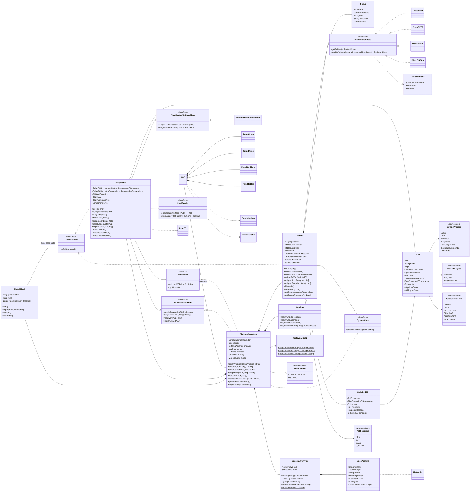
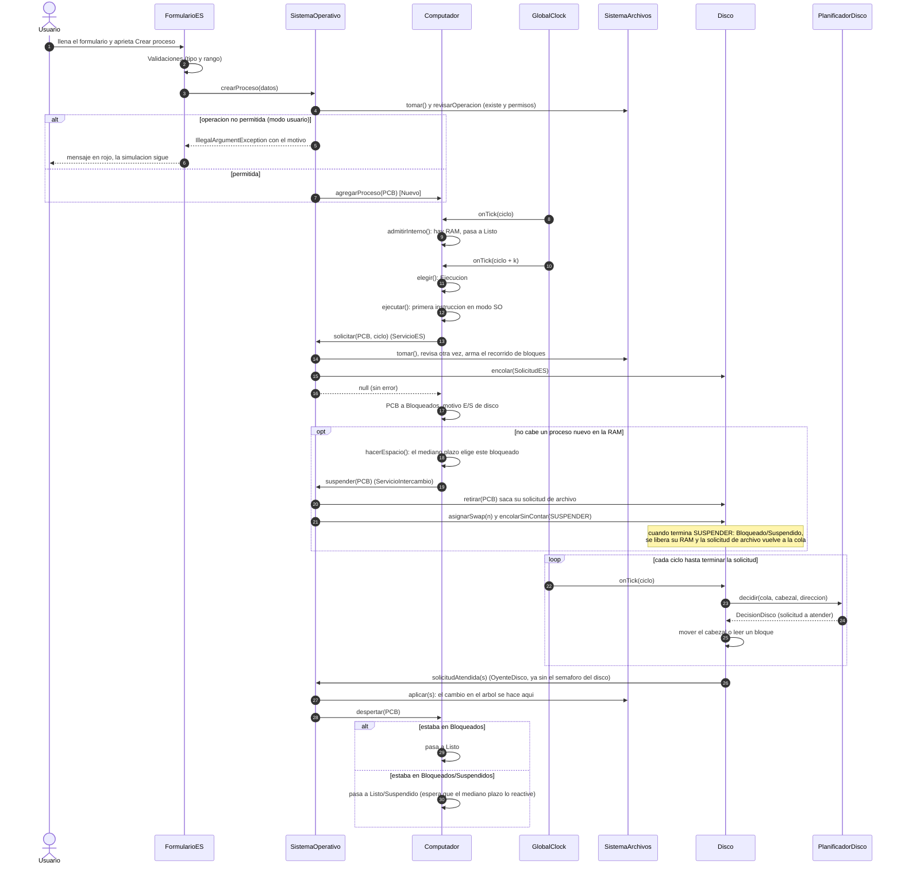

# AvilaOS - Proyecto 2: sistema de archivos, planificacion de disco y suspension de procesos

Sistemas Operativos, trimestre 2627-1. Integrantes: Vyckhy, Andrea y Diego.

> Quien escribe cada parte: **Diego** redacta el informe completo (secciones 1 a 5 y 7). Los diagramas UML de la seccion 6 los hacen **Vyckhy** (clases) y **Andrea** (secuencia). Cada uno revisa la descripcion de las clases que programo.

---

## 1. Como esta organizado el sistema (Diego)

AvilaOS separa el **hardware simulado**, el **sistema operativo** y la **interfaz**:

- **Hardware que obedece al reloj.** `GlobalClock` es un hilo que en cada ciclo llama a `onTick` de cada componente registrado, en este orden: `Computador` y despues `Disco`. Los dos implementan la interfaz `ClockListener`, y cada uno avanza exactamente un ciclo de trabajo por tick.
- **Sistema operativo.** `SistemaOperativo` arma y conecta todo: el computador, el disco, el sistema de archivos (`SistemaArchivos`), el log y las metricas. Es quien valida las operaciones, arma las solicitudes de E/S y aplica los cambios cuando el disco termina.
- **Interfaz.** Las ventanas (`main` y los paneles) piden copias del estado (`copiarColas`, `copiarBloques`, `copiarArbol`) con un `Timer` y las dibujan. Lo unico que le piden al sistema es crear procesos, cambiar politicas y el modo de usuario.

**Semaforos (`java.util.concurrent.Semaphore`).** Hay uno en `Computador` (las colas), uno en `Disco` (la cola de E/S, el mapa de bloques y el cabezal) y uno en `SistemaArchivos` (el arbol). Cuando hay que tomar mas de uno se toman siempre en el orden *computador, archivos, disco*, y el disco avisa que termino una solicitud ya con su semaforo suelto. Asi no puede haber interbloqueo.

**Estructuras propias.** No se usa ninguna coleccion de Java: las colas de procesos son `Cola<T>`, la cola de E/S y los hijos de un directorio son `Listas<T>` (lista enlazada) y el mapa de bloques es un arreglo de `Bloque`.

## 2. Clases y metodos mas importantes (Diego)

### Hardware y reloj
| Clase | Que hace | Metodos clave |
|---|---|---|
| `GlobalClock` | Hilo del reloj global; se puede pausar, reanudar y cambiar la duracion del ciclo. | `run`, `agregar`, `pausar`, `reanudar` |
| `Computador` | CPU y RAM, las siete colas de procesos, el planificador de CPU y el planificador a mediano plazo. | `onTick`, `admitirInterno`, `ejecutar`, `despertar`, `hacerEspacio`, `revisarReactivacion`, `suspensionLista`, `reactivacionLista` |
| `Disco` | Disco simulado: mapa de bloques (archivos y area de intercambio), cabezal con su direccion, cola unica de E/S. Atiende una solicitud a la vez. | `onTick`, `trabajar`, `mover`, `encolar`, `retirar`, `asignar`, `asignarSwap`, `liberar`, `cadena` |
| `Bloque` | Un bloque: si esta ocupado, quien lo ocupa, color y el numero del **siguiente** bloque (asignacion encadenada; el ultimo guarda -1). | `ocupar`, `liberar`, `getSiguiente` |
| `SolicitudES` | Una solicitud en la cola del disco: proceso, operacion, ruta, recorrido de bloques y ciclo de llegada. | `getBloque`, `sumarHecho`, `termino` |

### Sistema operativo
| Clase | Que hace | Metodos clave |
|---|---|---|
| `SistemaOperativo` | Conecta todo. Implementa `ServicioES` (el computador le pide la E/S), `OyenteDisco` (el disco le avisa que termino) y `ServicioIntercambio` (el mediano plazo le pide suspender y reactivar). | `crearProceso`, `revisarOperacion`, `solicitar`, `solicitudAtendida`, `aplicar`, `suspender`, `reactivar`, `guardarArchivos` |
| `SistemaArchivos` | Arbol de directorios y archivos con CRUD y permisos. | `buscar`, `crear`, `quitar`, `renombrar`, `revisarPermiso` |
| `NodoArchivo` | Un directorio o archivo: nombre, dueño, permiso, primer bloque, cantidad de bloques, hijos. | `buscarHijo`, `agregarHijo`, `getRuta` |
| `DiscoFIFO`, `DiscoSSTF`, `DiscoSCAN`, `DiscoCSCAN` | Las cuatro politicas de disco. Reciben la cola, la posicion y direccion del cabezal y devuelven una `DecisionDisco` (que solicitud atender, o ir a un extremo). | `decidir` |
| `MedianoPlazoAntiguedad` | Criterio del planificador a mediano plazo (ver seccion 4). | `elegirParaSuspender`, `elegirParaReactivar` |
| `ArchivosJSON`, `ConfigArchivos`, `ConfigProcesos` | Carga y validacion de los dos JSON y guardado del sistema de archivos. | `cargarArchivos`, `cargarProcesos`, `guardarArchivos`, `validar` |
| `Metricas` | Metricas del Proyecto 1 para un solo computador, mas suspensiones, reactivaciones y el historial del desplazamiento del cabezal para el grafico. | `registrarCiclo`, `registrarSuspension`, `registrarDisco` |
| `Validaciones` | Validacion de tipo y rango de todos los campos de entrada. | `leerTexto`, `leerEntero`, `leerDecimal` |

### Interfaz
`main` (ventana principal), `inicio` (exige cargar los dos JSON antes de arrancar), `PanelColas` (las 7 colas), `panelPCB`, `PanelArchivos` (JTree e informacion del nodo), `PanelDisco` (mapa de bloques con el cabezal), `PanelTablas` (cola de E/S y tabla de asignacion con colores), `FormularioES` (crear procesos de E/S), `PanelMetricas` (metricas y graficos con JFreeChart), `Panellog`.

### Flujo de una operacion de E/S
1. El usuario llena `FormularioES`. `Validaciones` revisa tipos y rangos; `SistemaOperativo.crearProceso` revisa que la ruta exista y los permisos. Si algo falla se explica en la ventana y la simulacion sigue.
2. El proceso entra a **Nuevo**; cuando hay RAM pasa a **Listo**.
3. Cuando obtiene la CPU, su primera instruccion se ejecuta en modo SO: `Computador.ejecutar` llama a `ServicioES.solicitar`, que arma la `SolicitudES` con el recorrido de bloques y la encola en el disco. El proceso pasa a **Bloqueado** (motivo: E/S de disco).
4. En cada ciclo el disco le pregunta a la politica activa que sigue, mueve el cabezal (N posiciones por ciclo) o lee/escribe un bloque (1 ciclo por bloque).
5. Al terminar, `OyenteDisco.solicitudAtendida` aplica el cambio en el sistema de archivos y despierta al proceso, que pasa a **Listo**.

## 3. Enums e interfaces (Diego)

**Enums**

| Enum | Valores | Para que |
|---|---|---|
| `EstadoProceso` | Nuevo, Listo, Ejecucion, Bloqueado, ListoSuspendido, BloqueadoSuspendido, Terminado | Modelo de siete estados. |
| `TipoOperacionES` | CREAR, LEER, ACTUALIZAR, ELIMINAR, SUSPENDER, REACTIVAR | Operacion de cada solicitud de E/S. |
| `PoliticaDisco` | FIFO, SSTF, SCAN, C_SCAN | Politica de planificacion de disco. |
| `ModoUsuario` | ADMINISTRADOR, USUARIO | Modo de uso. |
| `MotivoBloqueo` | NINGUNO, ES_DISCO, SUSPENSION | Por que esta bloqueado un proceso (se muestra en las colas y el PCB). |
| `DireccionCabezal` | ARRIBA, ABAJO | Direccion del cabezal. |
| `TipoNodo` | ARCHIVO, DIRECTORIO | Tipo de nodo del arbol. |
| `Permiso` | PUBLICO, PRIVADO | Permiso de un archivo. |
| `TipoProceso` | CPU_BOUND, ES | Tipo de proceso. |
| `PoliticaPlanificacion`, `ModoCPU` | (del Proyecto 1) | Politica de CPU y modo de la CPU. |

**Interfaces**

| Interfaz | La implementan | Para que |
|---|---|---|
| `ClockListener` | `Computador`, `Disco` | Todo lo que avanza con el reloj. |
| `PlanificadorDisco` | `DiscoFIFO`, `DiscoSSTF`, `DiscoSCAN`, `DiscoCSCAN` | Agregar una politica nueva (LOOK, por ejemplo) es crear una clase y agregarla al enum y a `SelectorPoliticaDisco`; `Disco` no cambia. |
| `PlanificadorMedianoPlazo` | `MedianoPlazoAntiguedad` | Criterio para escoger a quien suspender y a quien reactivar. |
| `ServicioES` | `SistemaOperativo` | El computador le pide la E/S al sistema operativo sin conocerlo. |
| `OyenteDisco` | `SistemaOperativo` | El disco avisa que termino sin conocer al sistema operativo. |
| `ServicioIntercambio` | `SistemaOperativo` | El mediano plazo pide suspender y reactivar. |
| `Planificador` | `FCFS`, `Roundrobin`, `EDF`, `Prioridades` | Politicas de CPU (Proyecto 1). |

## 4. Suspension y planificador a mediano plazo (Diego, revisado por Andrea)

- **Cuando se suspende.** Si un proceso nuevo no cabe en la RAM, el mediano plazo elige un **Bloqueado** y genera una solicitud `SUSPENDER` que escribe tantos bloques en el area de intercambio como unidades de memoria tiene el proceso. Cuando el disco termina, se libera su RAM y pasa a **Bloqueado/Suspendido**. Si no hay espacio en el area de intercambio, no se suspende y se registra en el log.
- **A quien.** Al que lleva mas tiempo bloqueado; si empatan, al de menor prioridad. El que lleva mas tiempo bloqueado es el que mas tiempo lleva ocupando RAM sin usarla; la prioridad solo desempata para no sacar a uno importante cuando da igual cual sacar.
- **Una sola solicitud por proceso.** Solo se suspende a un proceso cuya solicitud de archivo sigue esperando en la cola (no la que el disco esta atendiendo). Esa solicitud se saca de la cola mientras se hace el `SUSPENDER` y vuelve a entrar cuando termina; asi un proceso nunca tiene dos solicitudes en el disco.
- **Su evento ocurre.** Cuando termina su solicitud de archivo, pasa de Bloqueado/Suspendido a **Listo/Suspendido**.
- **Reactivar.** Cuando un proceso termina y libera RAM, el mediano plazo revisa los Listo/Suspendidos **antes** que los nuevos (ya fueron admitidos una vez y si no se les da prioridad se pueden quedar afuera para siempre). Se le aparta la RAM de una vez, se genera `REACTIVAR` (lee sus bloques del area de intercambio) y al terminar se liberan esos bloques y pasa a **Listo**. La memoria que libera una suspension es para el nuevo que la provoco.

## 5. Conclusiones (Diego)

Numeros reales de las pruebas por consola (`pruebas.PruebaDisco` y `pruebas.PruebaSuspension`).

### 5.1 Ejemplo del anexo (cabezal en 50, 1 posicion por ciclo)

| Politica | Orden | Desplazamiento |
|---|---|---|
| FIFO | 82, 17, 43, 140, 24, 16, 190 | 518 |
| SSTF | 43, 24, 17, 16, 82, 140, 190 | 208 |
| SCAN | 82, 140, 190, (199), 43, 24, 17, 16 | 332 |
| C-SCAN | 82, 140, 190, (199, salta al 0), 16, 17, 24, 43 | 192 (sin contar el salto) |

Los cuatro coinciden con el anexo del enunciado.

### 5.2 Casos P1 a P4 con el sistema completo (8 procesos de E/S, cabezal a 5 posiciones por ciclo)

| Politica | Orden de atencion | Desplazamiento | Espera promedio en la cola | Ciclos hasta terminar |
|---|---|---|---|---|
| FIFO | 95, 180, 34, 119, 11, 123, 62, 64 | 644 | 70.5 ciclos | 148 |
| SSTF | 62, 64, 34, 11, 95, 119, 123, 180 | 236 | 24.4 ciclos | 66 |
| SCAN | 62, 64, 95, 119, 123, 180, 34, 11 | 337 | 25.8 ciclos | 87 |
| C-SCAN | 62, 64, 95, 119, 123, 180, 11, 34 | 183 | 22.0 ciclos | 57 |

- **FIFO** es la peor en todo: el cabezal va y viene de un extremo al otro (50 a 95, a 180, a 34...). Recorre 3.5 veces mas que C-SCAN y la espera promedio triplica la de las demas. Es justa (atiende en orden de llegada) pero no tiene en cuenta donde esta el cabezal.
- **SSTF** baja mucho el desplazamiento (236) y la espera (24.4), porque siempre va a la mas cercana. Su problema es la inanicion: si siguen llegando solicitudes cerca del cabezal, una lejana (aqui el 180) puede quedarse esperando mucho.
- **SCAN** recorre un poco mas que SSTF (337) porque llega hasta el bloque 199 antes de regresar, aunque no haya nada ahi, pero ninguna solicitud espera mas de dos barridos: no hay inanicion.
- **C-SCAN** dio el menor desplazamiento (183) y la menor espera (22.0) en este caso, porque despues del 180 salta al 0 sin contar el regreso y atiende 11 y 34 de subida. Ademas el tiempo de espera es mas parejo que en SCAN: los bloques del principio no tienen que esperar a que el cabezal baje todo el disco.
- En resumen: para estas cargas, **C-SCAN y SSTF** son las mejores en desplazamiento y espera; **SCAN y C-SCAN** son las que evitan la inanicion. FIFO solo sirve como referencia.

### 5.3 Efecto de la suspension (`datos/procesos_suspension.json`: RAM de 64 MB, 7 procesos que en total piden 120 MB, area de intercambio de 100 bloques)

| Politica | Suspensiones | Reactivaciones | Desplazamiento | Espera promedio | Ciclos | Terminados |
|---|---|---|---|---|---|---|
| FIFO | 3 | 3 | 1093 | 101.3 | 401 | 7/7 |
| SSTF | 2 | 2 | 607 | 49.6 | 248 | 7/7 |
| SCAN | 2 | 2 | 779 | 65.6 | 283 | 7/7 |
| C-SCAN | 2 | 2 | 480 | 54.8 | 223 | 7/7 |

- **La suspension permite que terminen todos los procesos aunque no quepan juntos en la RAM.** Sin ella, P5 y P6 se quedarian en Nuevo hasta que algun proceso terminara.
- **Tiene un costo alto en disco.** Cada suspension y cada reactivacion son solicitudes que escriben o leen 16 bloques del area de intercambio (bloques 200 a 299), asi que el cabezal tiene que ir y volver entre la zona de archivos y la de intercambio. Comparando con P1 a P4 (que tienen un proceso mas), el desplazamiento sube entre 1.7 veces (FIFO) y 2.6 veces (SSTF y C-SCAN) con la misma politica.
- **La politica de disco cambia cuantas suspensiones hacen falta.** Con FIFO las solicitudes de intercambio esperan su turno detras de las de archivos; los procesos quedan mas tiempo bloqueados y hace falta suspender uno mas (3 contra 2). Con SSTF y C-SCAN el disco atiende antes lo que esta cerca y los procesos se liberan antes.
- Al terminar todas las corridas el area de intercambio queda vacia (100 de 100 libres): cada bloque que ocupa un `SUSPENDER` lo libera su `REACTIVAR` o el final del proceso.

## 6. Diagramas UML

Los diagramas estan en Mermaid: GitHub los dibuja directamente en este archivo. El codigo tambien esta suelto en `docs/uml_clases.mmd` y `docs/uml_secuencia_es.mmd`, y ya dibujados en `.png` para el PDF.

### 6.1 Diagrama de clases (Vyckhy)
Muestra los tres niveles (reloj y hardware, sistema operativo, interfaz), las interfaces y quien las implementa, y los enums. Imagen para el PDF: `docs/uml_clases.png`.

### 6.2 Diagrama de secuencia de una operacion de E/S (Andrea)
Sigue una lectura desde que el usuario llena el formulario hasta que el proceso vuelve a Listo, incluyendo el caso en que el mediano plazo lo suspende mientras espera. Imagen para el PDF: `docs/uml_secuencia_es.png`.

## 7. Como ejecutar y probar (Diego)

1. Abrir `AvilaOS` en NetBeans (Java 21) y ejecutar: la clase principal es `interfaz.inicio`.
2. Cargar los dos JSON (vienen sugeridos los de `datos/`) y *Abrir el simulador*. *Iniciar* arranca el reloj.
3. Para ver la suspension: cargar `datos/procesos_suspension.json`.
4. Pruebas por consola (clic derecho > *Run File*): `pruebas.PruebaDisco`, `PruebaSuspension`, `PruebaPermisos`, `PruebaArchivos`.
